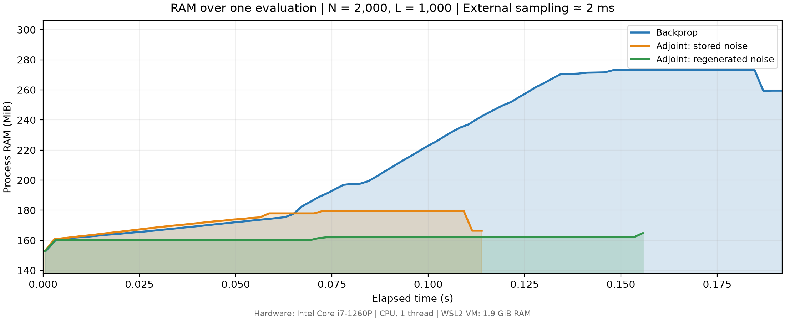
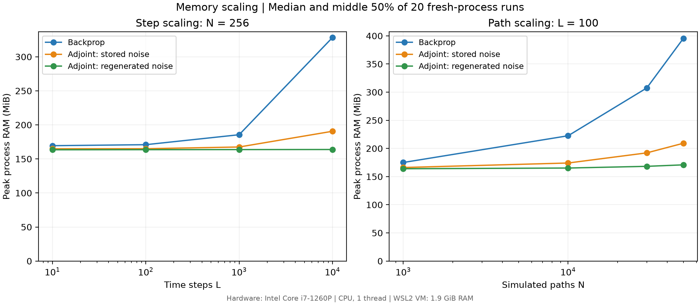
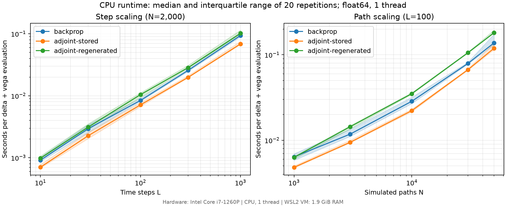

# Sample results

CPU float64, one thread; Intel Core i7-1260P, WSL2 (1.9 GiB RAM).

## RAM during one evaluation

- Same paths and steps for all methods; each curve ends when its evaluation finishes.
- Backprop retains more RAM; regenerating noise keeps RAM lower.
- Representative single runs, sampled about every 2 ms.

## Memory scaling

- Left: vary steps at 256 paths. Right: vary paths at 100 steps.
- Regenerated-noise adjoint stays nearly flat as steps increase.
- Median and middle 50% of 20 fresh-process measurements per configuration.

## Runtime scaling

- Left: vary steps at 2,000 paths. Right: vary paths at 100 steps.
- Stored-noise adjoint is fastest here; regenerating noise trades speed for memory.
- Median and middle 50% of 20 timings after warm-up, including noise and both passes.

## Files

- **PDFs:** same names as the plots, for slides.
- **Runtime data:** [raw timings](runtime_samples.csv), [summary](runtime_summary.csv).
- **Memory data:** [raw measurements](memory_repeated_samples.csv), [summary](memory_repeated_summary.csv).
- **Timeline data:** [RAM samples](memory_timeline_samples.csv), [phase markers](memory_timeline_phases.csv).

This is a fixed sharing snapshot; new runs write to the ignored `results/` folder.
